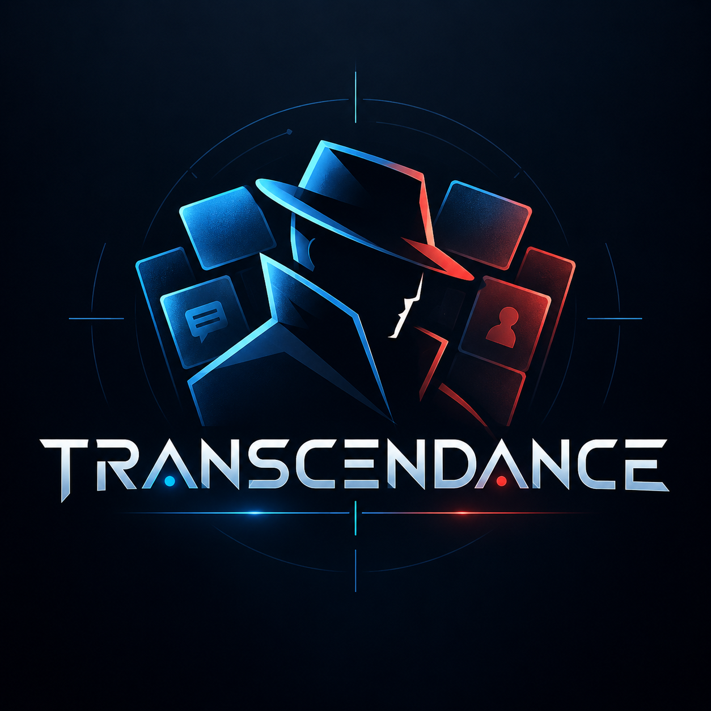

# ft_transcendence

*This project has been created as part of the 42 curriculum by gpollast, erpascua, fmotte, sbrochar, bsuger*

## Description

<p align="center">
  
</p>

ft_transcendence is the final group project of the 42 school Common Core.

The goal of the project is to build a complete web application, from front end to back end.
Its educational purpose is to push students to work with technologies they have not encountered in the previous projects of the curriculum.

Our project, **Happy End**, is an online adaptation of the tabletop game [Codenames](https://www.codenamesgame.com/).

Play with your friends the way you want: create an account, or jump straight into a quick game as a guest.

A classic game of Codenames needs four players. One or two short? No problem: **Fmotte**, our AI agent, has your back.
Our state-of-the-art AI can take on the role of Spymaster, leaving you free to guess the words and, who knows, maybe even win a few games. Think you're good enough? Bring your friends and find out who the best spy really is.

Blocked in your country? Restricted internet access? A spy getting bored in the middle of a mission? Don't worry: our platform is also reachable over the Tor network, so players from all over the world can play together. Come and play, and share your secrets with us.


## Instructions

### Prerequisites

To run the project, you need:

* A Linux system
* Podman 5.8.9 
* podman-compose 1.6.0
* GNU Make 4.4.1

### Environment variables

The project is configured through a `.env` file at the root of the repository. Create it from `.env.example` and set the following values:

| Variable | Default value | Description |
| :--- | :--- | :--- |
| `NEXT_DEV_PORT` | `3000` | Host port of the Next.js development server (only used by `make dev`). |
| `NGINX_PORT` | `8080` | Host port for HTTP. Every request is redirected to HTTPS. |
| `NGINX_SSL_PORT` | `8443` | Host port for HTTPS. This is the port used to reach the website. |
| `POSTGRES_DB` | `transcendence` | Name of the PostgreSQL database. |
| `POSTGRES_USER` | `transcendence` | PostgreSQL user used by the application. |
| `POSTGRES_PASSWORD` | `changeme` | Password of the PostgreSQL user. |
| `POSTGRES_PORT` | `5432` | Port PostgreSQL listens on inside the container network (not published on the host). |
| `POSTGRES_MONITORING_PASSWORD` | `changeme` | Password of the `monitoring` PostgreSQL user, used by postgres-exporter to collect metrics. |
| `GRAFANA_ADMIN_USER` | `admin` | Username of the Grafana administrator (Grafana is served at `/grafana/`). |
| `GRAFANA_ADMIN_PASSWORD` | `changeme` | Password of the Grafana administrator. |
| `ELASTIC_PASSWORD` | `changeme` | Password of `elastic`, the built-in Elasticsearch superuser. |
| `KIBANA_SYSTEM_PASSWORD` | `changeme` | Password of `kibana_system`, the service account Kibana uses to connect to Elasticsearch. |
| `KIBANA_USER_PASSWORD` | `changeme` | Password of `kibana_user`, the account you log in to Kibana with (Kibana is served at `/kibana/`). |
| `LOGSTASH_INTERNAL_PASSWORD` | `changeme` | Password of `logstash_internal`, the account Logstash uses to write logs to Elasticsearch. |
| `ES_MONITORING_PASSWORD` | `changeme` | Password of `monitoring_internal`, the read-only account used by elasticsearch-exporter. |
| `KIBANA_ENCRYPTION_KEY` | *generated by `make`* | Encryption key for Kibana saved objects (32 characters minimum). |
| `AUTH_SECRET` | *generated by `make`* | Secret used by Auth.js to sign and encrypt session tokens. |
| `AUTH_TRUST_HOST` | `true` | Tells Auth.js to trust the host header forwarded by the reverse proxy. Keep it set to `true`. |
| `MAILPIT_UI_USER` | `admin` | Username for the Mailpit web interface (served at `/mailpit/`). |
| `MAILPIT_UI_PASSWORD` | `change_me` | Password for the Mailpit web interface. |
| `REALTIME_DEV_PORT` | `3001` | Host port of the real-time (Socket.IO) server, used by the development front end (`make dev`). |

### Launching the project

```sh
git clone git@github.com:The-42-Chosen/ft_transcendence.git
cd ft_transcendence
cp .env.example .env
vim .env # set your environment variables
make
```

When it finishes, `make` prints the address of the website, which is served over HTTPS (port 8443 by default).

To stop the project, run `make down`. To also remove the containers, volumes and images, run `make fclean` (this deletes all stored data, including the database).

### Storage location

We are not root on the 42 school computers, and by default Podman stores everything in `~/.local/share/containers/storage`. Since the 42 home directory has a size quota, the Makefile uses `/goinfre` instead whenever it is available, and falls back to the default path otherwise.

To do so, the Makefile prepares the storage before running any Podman command:

* `STORE` selects the storage path: `/goinfre/<login>/containers` if `/goinfre/<login>` exists, the default path otherwise.
* `CONTAINERS_STORAGE_CONF` is exported. It is the environment variable Podman reads to know which storage configuration file to use.
* The `storage` rule creates `.podman/storage.conf`, whose `graphroot` is set to the `STORE` path. This is where Podman keeps everything persistent (images, containers, volumes...).

Run `make info` to see which location is in use.

`CONTAINERS_STORAGE_CONF` is only set inside `make`. To run `podman` commands by hand on a 42 machine, export it first:

```sh
export CONTAINERS_STORAGE_CONF="$PWD/.podman/storage.conf"
```

## Team Information

The subject requires three roles to be assigned: Product Owner, Project Manager and Technical Lead. Every member is also a Developer by default, and members can take on custom roles in addition to the mandatory ones.

* **Eric Pascual**: Product Owner, Developer

  Drawing on his experience with web projects before 42, Eric managed the backlog and helped prioritize the work to be done. He prioritized the features, made the final call when the team had to choose between them, and validated the completed work against the requirements of the subject.

* **Guillaume Pollastri**: Technical Lead, Developer

  Guillaume handled a large part of the back-end development, including its most sensitive part: user management. He also helped choose the technical stack of the application and the tools used by the team.

* **Florent Motte**: AI Specialist, Developer

  Florent, a respected member of the 42 AI association, was our AI specialist. His intra login gave its name to our AI. He also set up the communication channel between his service and the back end.

* **Salomé Brochard**: Tor Specialist, Developer

  Salomé made the service available over Tor, added support for several languages, and built the front end of several parts of the project.

* **Benjamin Suger**: Project Manager, DevOps, Developer

  Benjamin set up the environment with Podman, GitHub Actions as the CI pipeline, and the Makefile. He also managed the observability of the project with the ELK stack and Prometheus/Grafana.

## Project Management

**Work organization**: Over several meetings, we identified which parts of the project interested each member of the team, which helped us set the project goals. From there, the organization came naturally: each member worked on a separate part, and the parts were then linked together.

**Project management tools**: GitHub, where we keep our backlog.

**Communication channels**: Discord, and in person at school.

## Technical Stack

### Frontend

| Technology | Version | Role |
| :--- | :--- | :--- |
| Next.js (App Router) | 16.3.6 | Pages and routing |
| React | 19.2.8 | UI components |
| TypeScript | 5 | Static typing for the whole code base |
| Tailwind CSS | 4 | Styling |
| socket.io-client | 4.8 | Live game updates |

The interface is available in English, French and Spanish through JSON translation files (`src/i18n`).

We chose Next.js because it lets us write the front end and the back end in a single TypeScript code base: the pages and the API share the same types, the same validation rules and the same container.

### Backend

| Technology | Version | Role |
| :--- | :--- | :--- |
| Next.js Route Handlers | 16.3.6 | REST API (`/api/users`, `/api/friends`, `/api/rooms`...) |
| Auth.js (`next-auth`) | 5.0 beta | Authentication with email and password |
| bcryptjs | 3 | Password hashing |
| Zod | 4 | Validation of user input |
| Prisma (`@prisma/orm-postgres`) | 8.0 RC | Typed access to PostgreSQL, schema and migrations |
| Socket.IO on Node.js | 4.8 / 22 | Real-time service: keeps every player of a room in sync |
| Python + NumPy | 3.12 | AI Spymaster service |

The back end is split into three services, each in its own container:

* **next** serves the pages and the REST API.
* **realtime** is a small Socket.IO server dedicated to live game updates. Socket.IO gives us rooms, automatic reconnection and a fallback to HTTP long polling when WebSockets are not available.
* **ia** is the AI Spymaster. It relies on pre-trained fastText word vectors (the 100,000 most frequent words in English, French and Spanish) and uses NumPy to measure how close a candidate clue is to the words of its team, and how far it is from the opposing, neutral and assassin words. It needs no GPU and no external API, so it runs entirely inside the project.

### Database

We chose PostgreSQL (version 16), in line with two requirements from the subject.

**"The database must have a clear schema and well-defined relations."**
Our data (users, friendships) is inherently relational, which a SQL database expresses naturally through typed tables and foreign key constraints. A NoSQL document store would have required enforcing these relations in application code instead.

**"No data corruption or race conditions occur with simultaneous user actions."**
Multiple clients connected through WebSockets can trigger writes at the same time. Databases handle this differently. SQLite, for example, uses a database-wide lock: only one write can happen at a time, and concurrent writes must wait or be retried in application code. PostgreSQL solves this natively with MVCC (Multi-Version Concurrency Control): instead of locking, each write creates a new version of the affected rows, and each transaction reads from a consistent snapshot. Writes to different rows never block each other, and conflicts on the same row are resolved at row level. Concurrency safety is therefore guaranteed by the database engine itself.

### Infrastructure

| Technology | Role |
| :--- | :--- |
| Podman and podman-compose | Run every service in its own container |
| nginx | Single entry point of the platform |
| GitHub Actions | Continuous integration |
| Mailpit | Local mail server that receives the alert emails |
| Tor | Publishes the website as an onion service |

* **Podman** runs rootless, which is a requirement for us since we are not root on the 42 school computers.
* **nginx** is the entry point of the website. It terminates HTTPS (TLS 1.2 and 1.3, HTTP/2), redirects HTTP to HTTPS, and acts as a reverse proxy for the application, the real-time service, Grafana, Kibana and Mailpit.
* **GitHub Actions** validates the configuration files (compose file, Prometheus rules, Grafana dashboards, shell scripts) on every pull request, then starts the application, the monitoring stack and the ELK stack to check that they respond.

### Tor onion service

The platform is also published as a Tor onion service: it can be reached with Tor Browser through a `.onion` address.

* A dedicated **tor** container runs the onion service. It runs as a non-root user, with a read-only file system and without any Linux capability.
* This container sits on its own network and cannot reach the other services. Its only link to the platform is a pair of Unix sockets shared with nginx, which serves the same application as on the regular HTTPS port.
* The administration tools (Grafana, Kibana and Mailpit) are not exposed through the onion service.
* The `.onion` address is generated on first launch and written by `make` to the `add.onion` file. Its key is kept in a volume, so the address stays the same until `make fclean`.

We chose an onion service rather than simply letting Tor users reach the regular address because the connection then stays inside the Tor network from end to end. No exit node is involved, the IP address of the player is never revealed to the server, and the website is reachable from anywhere without a public IP address, a domain name or port forwarding.

### Log management: ELK

We use the Elastic Stack (Elasticsearch, Logstash and Kibana, version 8.19.25) to centralize the logs of the platform.

* **Logstash** collects the nginx access logs (written as JSON), the nginx error logs, and the application logs that the back end sends as structured JSON (authentication, game, API and user events). It parses them and sends them to Elasticsearch.
* **Elasticsearch** stores and indexes the logs. Security is enabled, and every component has its own account with only the rights it needs: Logstash can only write logs, the monitoring account is read-only, and a separate account is used to log in to Kibana.
* **Kibana** is the web interface used to search the logs. A data view and an nginx dashboard are imported automatically on first launch.

The log life cycle is automated. An index lifecycle policy starts a new index every day (or when it reaches 1 GB) and deletes logs after 30 days, and a snapshot of the logs is taken every night and kept for 90 days.

### Monitoring: Prometheus and Grafana

Prometheus (version 3.16.0) collects the metrics of the platform and Grafana (version 12.4.15) displays them.

* **Prometheus** scrapes its targets every 15 seconds and keeps 15 days of history. The metrics come from dedicated exporters:

  | Exporter | What it measures |
  | :--- | :--- |
  | node-exporter | Host machine (CPU, memory, disk) |
  | cAdvisor | Resource usage of each container |
  | postgres-exporter | PostgreSQL |
  | nginx-prometheus-exporter | nginx |
  | elasticsearch-exporter | Elasticsearch |
  | blackbox-exporter | Availability probes on the application, Logstash, Kibana, Mailpit and the AI service |

* **Alert rules** are evaluated by Prometheus: service down, failed probe, high CPU usage, high memory usage, disk almost full, PostgreSQL down, too many PostgreSQL connections, and Elasticsearch cluster in red state. These rules are unit-tested in the CI.
* **Grafana** is provisioned from files in the repository: the Prometheus data source, three dashboards (system, containers and PostgreSQL) and the alerting configuration are ready on first launch. When an alert fires, Grafana sends an email, which is caught by Mailpit.

`make crisis` stops a service on purpose to show the chain at work: Prometheus sees the service down, then the service is started again. With `ALERT=1`, the service stays down until the alert fires.

ELK and Prometheus are complementary. Metrics tell us that something is wrong (a service is down, memory is running out); logs tell us why.

## Database Schema:
◦ Visual representation or description of the database structure.
◦ Tables/collections and their relationships.
◦ Key fields and data types.

## Features List:

### Game

| Feature | Description | Team member(s) |
| :--- | :--- | :--- |
| Game rooms | Create a room in English, French or Spanish and share its code so that other players can join. | erpascua |
| Waiting room | Players pick their team and their role (Spymaster or agent) before the game starts. | erpascua |
| Codenames gameplay | The Spymaster gives a one-word clue and a number, the agents guess words on the board, and the teams take turns until one of them wins. | erpascua |
| Real-time play | Every move is sent instantly to all the players of the room. | fmotte, erpascua |
| AI Spymaster | An AI can replace the Spymaster of one or both teams and gives its clues in the language of the room. | fmotte |
| Guest play | Join a quick game with just a name, without creating an account. | erpascua |

### Users

| Feature | Description | Team member(s) |
| :--- | :--- | :--- |
| Registration and login | Create an account and log in with an email address and a password. | gpollast, bsuger |
| Profile | Edit a display name, a bio and a profile picture (JPEG, PNG or WebP, up to 2 MB). | gpollast |
| Public profile page | View the profile of another player. | gpollast |
| Player search | Search for other players. | gpollast |
| Friends | Add and remove friends, and see the list of friends. | gpollast |
| Online status | See which players are currently online. | gpollast |

### Interface

| Feature | Description | Team member(s) |
| :--- | :--- | :--- |
| Multiple languages | The website is available in English, French and Spanish, with a language selector. | sbrochar, erpascua |
| User interface | Reusable components shared by the whole website (header, navigation, game board, forms...). | erpascua, sbrochar |
| Legal pages | Terms of service, privacy policy, GDPR information and an About page. | erpascua, sbrochar |

### Access and security

| Feature | Description | Team member(s) |
| :--- | :--- | :--- |
| HTTPS | The whole website is served over HTTPS, and HTTP requests are redirected to it. | bsuger |
| Tor access | The website can be reached with Tor Browser through a `.onion` address. | sbrochar |

### Operations

| Feature | Description | Team member(s) |
| :--- | :--- | :--- |
| One-command launch | `make` builds and starts the whole platform. | bsuger |
| Centralized logs | The nginx and application logs are collected in one place and can be searched in Kibana. | bsuger |
| Monitoring and alerts | The metrics of the host, the containers and the services are displayed in Grafana dashboards, and alerts are sent by email. | bsuger |
| Continuous integration | Every pull request is checked automatically with GitHub Actions. | bsuger |
| Outage simulation | `make crisis` stops a service on purpose to show that the monitoring detects it. | bsuger |

## Modules:

Total points ; 25 / 19 (19 required to get 125% of the project, 14 for mandatory part)
Each Major add 2 points and Minor 1 point.

* **Major: Use a framework for both the frontend and backend.**

  We chose Next.js to write the pages and the API in a single TypeScript code base that shares its types and validation rules. The pages are built with React and the App Router, and the back end is a REST API made of Route Handlers under `/api`.

  *Team member(s): erpascua*

* **Major: Infrastructure for log management using ELK (Elasticsearch, Logstash, Kibana).**

  With more than fifteen containers, the logs had to be centralized to be usable. Logstash collects the nginx and application logs, Elasticsearch stores them with dedicated accounts, a 30-day retention policy and nightly snapshots, and Kibana is used to search them.

  *Team member(s): bsuger*

* **Major: Monitoring system with Prometheus and Grafana.**

  We wanted to know that a service is failing before a player tells us. Prometheus scrapes six exporters and evaluates eight alert rules, and Grafana displays three provisioned dashboards and sends the alerts by email.

  *Team member(s): bsuger*

* **Major: Introduce an AI Opponent for games.**

  Codenames needs four players, so an AI Spymaster lets smaller groups play. It is a Python service that scores candidate clues with pre-trained fastText word vectors and NumPy, in English, French and Spanish.

  *Team member(s): fmotte*

* **Major: Standard user management and authentication.**

  Accounts are required for profiles, friends and online status. Users register and log in with an email address and a password (Auth.js, passwords hashed with bcrypt), edit their profile, upload an avatar, add friends and see who is online.

  *Team member(s): gpollast*

* **Major: Implement a complete web-based game where users can play against each other.**

  The game is the heart of the project: an online adaptation of Codenames, with its rules and win conditions. The rules run on the server (`src/lib/game.ts`) behind a REST API, and the hidden colors of the cards are only sent to the Spymasters, so an agent cannot cheat.

  *Team member(s): erpascua, fmotte*

* **Major: Remote players — Enable two players on separate computers to play the same game in real-time.**

  Codenames is meant to be played with friends who are not in the same room, each on their own computer. Every client keeps a Socket.IO connection to the real-time service, which pushes the new state of the game to the room after each move.

  *Team member(s): erpascua*

* **Major: Allow users to interact with other users.**

  A social game needs players to find each other outside of a match. Users can search for other players, view their profile, and add or remove friends.
  #a completer : le chat n'est pas encore dans le code

  *Team member(s): gpollast, fmotte*

* **Major: Multiplayer game (more than two players).**

  Codenames is a team game: two teams, each with a Spymaster and one or more agents, so at least four players share the same match. All the clients of a room receive the same state from the real-time service, each with the view allowed by their role.

  *Team member(s): erpascua*

* **Minor: Custom-made design system with reusable components, including a proper color palette, typography, and icons (minimum: 10 reusable components).**

  A shared set of components keeps the interface consistent and avoids rewriting the same elements on every page. It contains 23 reusable React components (`src/components/reusables`), a color palette defined as CSS variables, and three fonts (Manrope, Bebas Neue and Special Elite).

  *Team member(s): erpascua*

* **Minor: Implement spectator mode for games.**

  Spectators let friends watch a match without taking a seat. From the home screen, a user can join a room as a spectator and follow the board in real time.

  *Team member(s): erpascua*

* **Minor: Support for multiple languages (at least 3 languages).**

  Codenames is a word game, so the language matters as much for the game as for the interface. The website is translated into English, French and Spanish with JSON files and a language selector, and the word lists and the AI exist in the three languages too.

  *Team member(s): sbrochar*

* **Minor: Use an ORM for the database.**

  An ORM gives us typed queries and versioned migrations instead of hand-written SQL. We use Prisma: the schema is described in `contract.prisma`, and the migrations are applied automatically when the platform starts.

  *Team member(s): gpollast*

* **Minor: Support for additional browsers.**

  Players should not have to install a specific browser to join a game.
  #a completer : navigateurs testes et limites constatees

  *Team member(s): erpascua, sbrochar*

* **Minor: Game statistics and match history (requires a game module).**

  Statistics and match history give players a reason to come back and to compare themselves with their friends.
  #a completer : implementation, le module n'est pas encore dans le code

  *Team member(s): gpollast*

* **Minor: Module of choice - Tor**

  Our theme is espionage, and we wanted the game to stay reachable for players whose internet access is restricted or monitored. It deserves to be a module because it adds a real feature (anonymous access) and required work on networking, isolation and TLS that no listed module covers. A dedicated Tor container publishes the website as an onion service and reaches nginx through Unix sockets, without any access to the other services.

  *Team member(s): sbrochar*


## Individual Contributions:

*Every member of the team wrote their own part of this section.*

### Eric Pascual


### Guillaume Pollastri


### Salomé Brochard


### Florent Motte


### Benjamin Suger

I created the CI pipeline, the Makefile and everything related to DevOps, and I implemented the two DevOps major modules (ELK and Prometheus/Grafana).

**Challenges**: The tests and the `make` process must not become a bottleneck for the rest of the team. I reworked them several times to make them fast enough not to slow the other members down.


## The use of AI

We used AI for the following tasks:

* It helped us write this document in correct English.
* It helped us with cybersecurity, through various tests run throughout the development of the website.
* The script behind `make crisis` was generated by AI.
